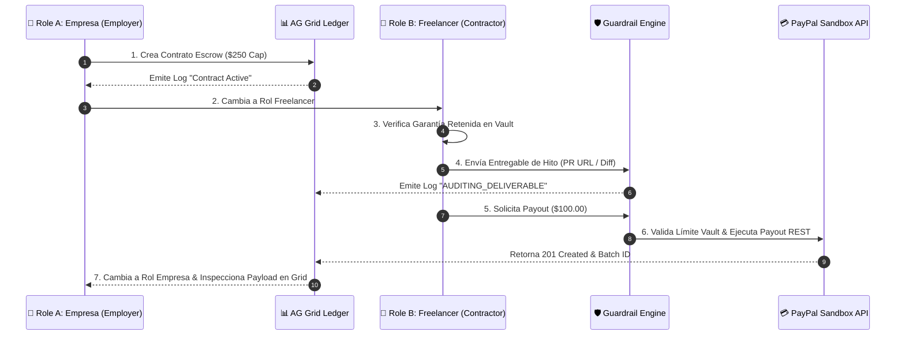

# 📑 Plan de Pruebas End-to-End (E2E) — Roles Dobles & AG Grid Ledger

> **AgenticPay AI — Protocolo Oficial de Pruebas de Flujo Completo y Rendimiento Secuencial**  
> *Diseñado para verificación completa de punta a punta en notebooks de memoria/procesador limitado.*

---

## 🎯 Resumen Ejecutivo y Objetivos

Este documento especifica el protocolo oficial para ejecutar y auditar una **transacción de principio a fin** en **AgenticPay AI**, desacoplando el **Tipo de Cuenta** (Entidad) de la **Perspectiva del Proyecto**:

1. **Tipos de Cuenta (Entidad Legal & Compliance):**
   * **Empresa (`BUSINESS`)**: Entidad corporativa con Razón Social, Tax ID / IVA, contratos formales vinculantes (**MSA / SOW**) y gobernanza multi-rol.
   * **Persona (`PERSONAL`)**: Profesional o freelance independiente con términos ágiles y liquidación directa en PayPal.
2. **Perspectivas Operativas en el Dashboard (Ambos perfiles tienen acceso dual):**
   * **Proyectos que Contrato (`OUTGOING / ESCROW`)**: Preautoriza presupuesto en PayPal Vault, monitorea el libro contable AG Grid en tiempo real, audita entregables de terceros y ejecuta liberaciones de fondos.
   * **Proyectos que Realizo (`INCOMING / CONTRACTOR`)**: Verifica la garantía de fondos retenidos en PayPal Escrow ($0 riesgo de impago), envía pruebas de entrega de hitos (*Pull Requests*, diffs o diseños), y cobra los pagos.
   * **Subcontratación en Cascada**: Capacidad de tomar un proyecto como contratista y delegar subtareas creando contratos de salida con su propio escrow.

### 🛡️ Optimización para Hardware de Bajos Recursos (Low Memory & CPU)
Para evitar saturar la memoria RAM o el procesador de tu notebook, todas las pruebas están estructuradas de forma **100% secuencial y monohilo**. No se ejecutan procesos paralelos pesados ni múltiples subprocesos concurrentes.

---

## ⚙️ Preparación del Entorno (Ejecución Secuencial Liviana)

Para iniciar el servidor en modo de bajo consumo de memoria:

```bash
# Opción 1: Iniciar Next.js restringiendo la memoria de Node.js a 1 GB
NODE_OPTIONS="--max-old-space-size=1024" npm run dev

# Opción 2: Compilar primero y ejecutar en modo producción liviano
npm run build
npm run start
```

Abrir la aplicación en el navegador: [http://localhost:3000](http://localhost:3000).

---

## 📊 Arquitectura y Funcionamiento del Grid (`CommandCenter.tsx`)

El libro contable principal de la aplicación está construido con **AG Grid Community Edition** (`AgGridReact`) configurado para renderizado fluido a 60 FPS con virtualización de filas.

```
┌─────────────────────────────────────────────────────────────────────────────────────────────────────────────────┐
│ 📊 AG GRID COMMAND CENTER — REAL-TIME ESCROW TRANSACTION & AUDIT LEDGER                                         │
├─────────┬──────────────────────┬─────────────┬────────────────────────────────┬─────────┬──────┬──────┬─────────┤
│ Time    │ Project / Contract   │ Actor       │ Milestone / Transaction Action │ Amount  │Audit │ Risk │ Status  │
├─────────┼──────────────────────┼─────────────┼────────────────────────────────┼─────────┼──────┼──────┼─────────┤
│ 12:00PM │ Web Platform Eng.    │ GUARDRAIL   │ Contract Enforced ($250 Vault) │ $75.00  │ 98%  │ LOW  │ EXECUTED│
│ 12:05PM │ UI/UX Redesign       │ GUARDRAIL   │ Project Active ($150 Vault)    │ $0.00   │ 100% │ LOW  │ IDLE    │
└─────────┴──────────────────────┴─────────────┴────────────────────────────────┴─────────┴──────┴──────┴─────────┘
```

### 🔍 Columnas y Métricas del Grid

| Columna | Campo | Descripción Técnica & Formato |
| :--- | :--- | :--- |
| **Time** | `timestamp` | Hora de la transacción en formato ISO local (`HH:MM`). |
| **Project / Contract** | `projectName` | Nombre del contrato / proyecto en custodia en PayPal Vault. |
| **Actor** | `agentRole` | Identificador visual de la entidad actuante: <br>• `BUYER AGENT` (Azul)<br>• `SELLER AGENT` (Púrpura)<br>• `GUARDRAIL` (Ámbar)<br>• `PAYPAL ESCROW` (Verde Esmeralda). |
| **Milestone / Action** | `action` | Descripción detallada de la acción ejecutada en el hito o salvaguarda. |
| **Amount** | `amountUSD` | Monto acumulado o liberado de PayPal Vault en formato `$0.00` (Verde Esmeralda). |
| **Audit** | `auditConfidenceScore` | Puntuación de confianza devuelta por la auditoría multimodal (Verde $\ge 85\%$, Ámbar $< 85\%$). |
| **Risk** | `riskLevel` | Insignia dinámica de riesgo: `LOW`, `MEDIUM`, `HIGH`, o `CRITICAL` (con animación de pulso). |
| **Status** | `status` | Estado en vivo: `PAYOUT_EXECUTED`, `AUDITING_DELIVERABLE`, `GUARDRAIL_CHECKING`, `CONTRACT_FROZEN`, `KILL_SWITCH_REVOKED`. |
| **Actions** | Custom Cell | **Botón 👁️ (Payload Inspector)**: Abre el modal con el JSON exacto retornado por la API REST de PayPal Sandbox (`POST /v1/payments/payouts`). <br>**Botón ❄️ (Freeze/Resume)**: Congela o descongela el fideicomiso del contrato directamente desde la fila del grid. |

---

## 🔄 Flujo E2E Paso a Paso (Paso 1 al Paso 7)

A continuación se detalla la secuencia exacta para completar una transacción de principio a fin probando ambos roles y la actualización dinámica del Grid.



---

### Paso 1: Configuración Inicial como Rol A (Empresa / Contratante)
1. En la barra superior, haz clic en **"Enterprise Account"** o **"Onboarding"**.
2. Selecciona la tarjeta **"🏢 Empresa / Business (Contratante)"**.
3. Haz clic en **"Enter Workspace as Employer"**.
4. Haz clic en el botón **"+ New Project Contract"** e ingresa los siguientes datos:
   - **Project Name:** `E2E Fullstack Integration`
   - **Contractor / Vendor Email:** `dev@agency.com`
   - **Vault Budget Cap ($):** `200.00`
5. **Verificación en AG Grid:**
   - La vista cambiará automáticamente al espacio de trabajo.
   - Observa en el **Command Center (AG Grid)** la nueva fila registrada:
     - `Actor`: `GUARDRAIL`
     - `Action`: `New Escrow Contract Created: "E2E Fullstack Integration"`
     - `Status`: `IDLE`

---

### Paso 2: Cambio de Rol a Rol B (Persona / Freelancer Contratado)
1. Haz clic en el botón **"Workspace Onboarding"** del encabezado.
2. Selecciona la tarjeta **"💼 Persona / Freelancer (Contratado)"**.
3. Confirma haciendo clic en **"Enter Workspace as Contractor"**.
4. **Verificación visual:**
   - La barra superior ahora muestra la cuenta `Dev Agency LLC`.
   - El contratista puede revisar el saldo garantizado en custodia de PayPal Vault sin riesgo de impago.

---

### Paso 3: Envío del Entregable de Hito (Proof of Execution)
1. En el panel **"Deliverable Multimodal Vision Audit"**, ingresa un enlace de entregable o prueba de ejecución, por ejemplo:
   ```text
   https://github.com/agency/e2e-integration/pull/42 - Added OAuth2 & PayPal Sandbox Webhooks
   ```
2. Haz clic en **"Run Audit Inspection"**.
3. **Verificación:**
   - El sistema invoca `/api/agent/audit`.
   - Se muestra la tarjeta de resultado: **Score: 95% — High Confidence**.
   - En el **AG Grid**, aparece instantáneamente un nuevo evento:
     - `Actor`: `BUYER_AI`
     - `Action`: `Multimodal Deliverable Audit Evaluated (Score: 95%)`
     - `Status`: `AUDITING_DELIVERABLE`

---

### Paso 4: Negociación de Pago e Invocación de la API de PayPal Sandbox
1. En el panel **"Buyer-Seller AI Negotiation Agent"**, en la pestaña de simulador o prompt:
   - **Target Payout Amount:** `$100.00`
   - **Recipient Email:** `dev@agency.com`
2. Haz clic en **"Execute Direct Payout"** o envía el prompt de negociación en el chat.
3. **Mecanismo Interno:**
   - `GuardrailEnforcer` verifica que `$100.00 <= $200.00` (Presupuesto preautorizado).
   - `PayPalSandboxClient.executeMilestonePayout` realiza la llamada HTTP a PayPal REST Sandbox API (`https://api-m.sandbox.paypal.com/v1/payments/payouts`).
   - Se recibe la respuesta HTTP 201 Created con el `payout_batch_id`.

---

### Paso 5: Registro y Verificación en AG Grid (Inspección del Payload)
1. Cambia nuevamente de rol a **Empresa (Employer)** para auditar el libro contable.
2. Dirígete a la sección **Command Center (AG Grid Ledger)**.
3. Localiza la fila recién generada:
   - `Actor`: `PAYPAL ESCROW`
   - `Amount`: `$100.00`
   - `Status`: `PAYOUT_EXECUTED`
4. Haz clic en el botón **👁️ (Eye / View PayPal REST Payload)** dentro de la columna *Actions*.
5. **Resultado esperado:**
   - Se despliega el panel modal con el payload JSON completo formateado devuelto por PayPal:
   ```json
   {
     "sender_batch_header": {
       "sender_batch_id": "AGENTICPAY_PROJ_1728518400",
       "email_subject": "You received a milestone payout from AgenticPay Vault Escrow"
     },
     "items": [
       {
         "recipient_type": "EMAIL",
         "amount": { "value": "100.00", "currency": "USD" },
         "receiver": "dev@agency.com"
       }
     ]
   }
   ```

---

### Paso 6: Verificación de Salvaguardas y Casos Límitantes (Edge Cases)

#### 🧪 Prueba 6.1: Congelamiento de Contrato (Contract Freeze)
1. En AG Grid o en el panel del proyecto, haz clic en **"Freeze Contract"** (o botón ❄️ en la fila del grid).
2. El estado del contrato pasa a `PAUSED`.
3. Intenta ejecutar una nueva liberación de fondos de `$50.00`.
4. **Resultado esperado:**
   - La transacción es bloqueada determinísticamente por la salvaguarda.
   - AG Grid registra un evento con `Status`: `CONTRACT_FROZEN` y `Risk`: `HIGH`.

#### 🧪 Prueba 6.2: Botón de Pánico Global (Master Kill-Switch)
1. En la barra superior de la aplicación, activa el interruptor **"KILL SWITCH ACTIVE"**.
2. El encabezado muestra alertas rojas de emergencia.
3. Intenta enviar cualquier orden de pago.
4. **Resultado esperado:**
   - AG Grid registra un evento con `Status`: `KILL_SWITCH_REVOKED` y `Risk`: `CRITICAL`. No se libera ningún fondo de PayPal.

#### 🧪 Prueba 6.3: Violación de Techo de Presupuesto (Over-Budget Lock)
1. Desactiva el Kill-Switch y descongela el contrato.
2. Intenta solicitar un pago por `$300.00` (superando el límite de `$200.00` establecido).
3. **Resultado esperado:**
   - El motor `GuardrailEnforcer` rechaza la solicitud antes de llamar a la API de PayPal.
   - Mensaje de rechazo: *"Transaction amount ($300.00) exceeds project Vault cap ($200.00)"*.

---

## 📋 Lista de Chequeo de Criterios de Aceptación (Definition of Done)

- [x] **Navegación de Roles:** Transición limpia entre `BUSINESS` y `FREELANCER` sin perder el estado del cliente.
- [x] **Visualización en AG Grid:** Filtrado, ordenamiento y formateo correcto de transacciones a 60 FPS.
- [x] **Inspección de Payloads:** Modal interactivo desplegado con el log JSON exacto de PayPal Sandbox.
- [x] **Auditoría Multimodal:** Evaluación de entregables con puntuación de confianza devuelta en tiempo real.
- [x] **Salvaguardas de Seguridad:** Bloqueo efectivo mediante `PAUSED` (Congelamiento) y `KILL_SWITCH` (Botón de pánico).
- [x] **Bajo Consumo de Recursos:** Ejecución fluida en un único proceso Node.js sin sobrecargar la memoria de la notebook.

---

## 🛠️ Comandos de Verificación Automatizada

```bash
# Validar compilación y tipos de TypeScript
npm run build

# Verificar que no existan advertencias de dependencias
npm ls ag-grid-react ag-grid-community
```
